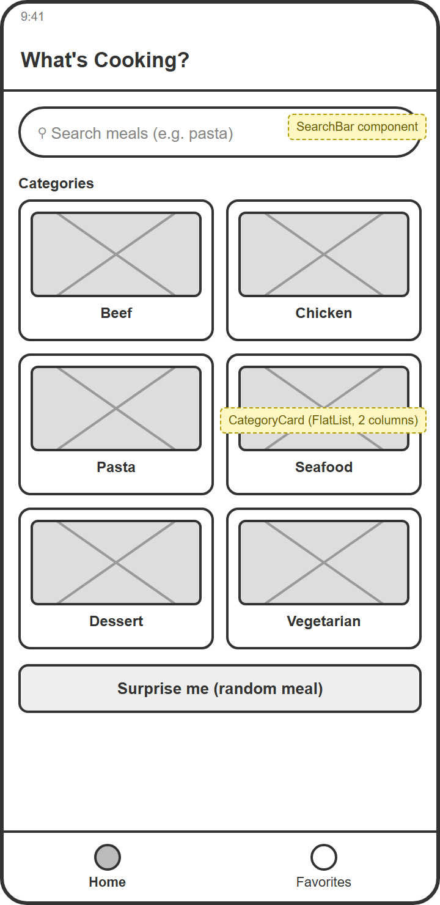
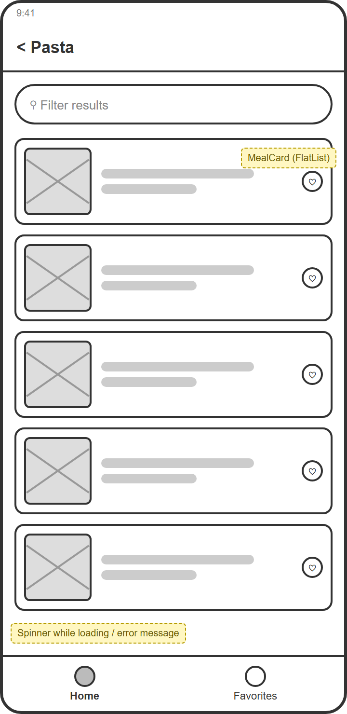
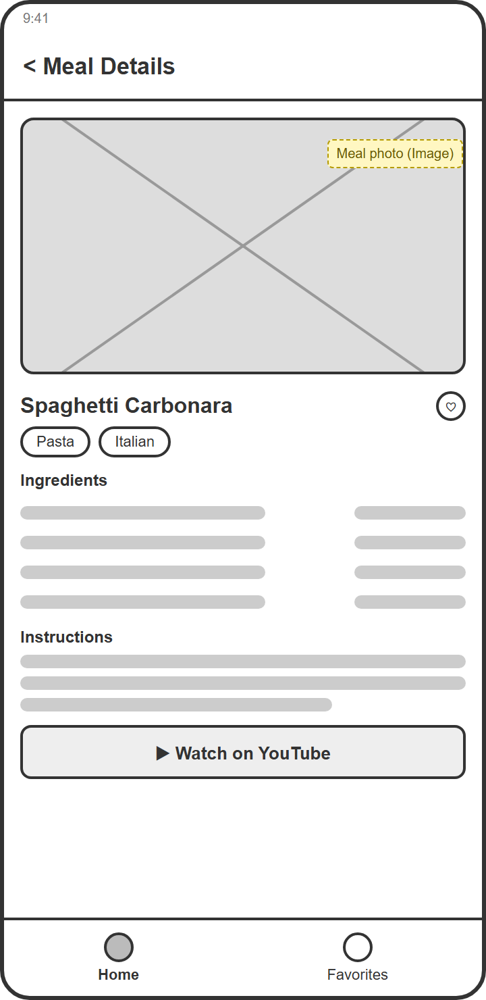
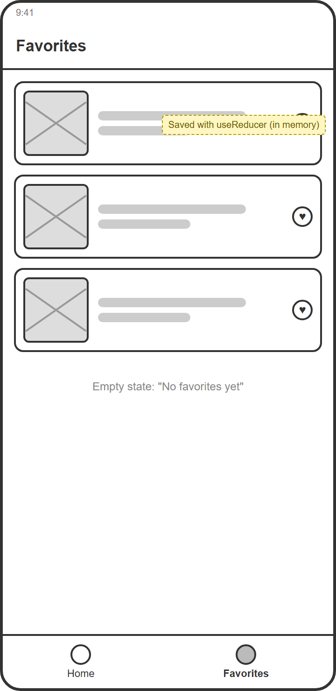

# What's Cooking? - Recipe Finder App

Final project for **Mobile Application Development with React Native I (SODV2205-02)**.

**Team Code & Cook**
- Otavio Juan Menoni (474469)
- Julia Ferreira Moraes Welerson (474397)

**Repository:** https://github.com/OtavioJM/WhatsCooking

> Status: proposal phase. The app code will be added during development.

## Project Overview

What's Cooking? is a React Native (Expo) app that helps users find meals to cook.
Users can search for a meal by name or browse by category, see the results with photos,
and open a meal to view the ingredients, instructions and a YouTube video.
All data comes live from a public API (no local data or database).

## API Used

[TheMealDB](https://www.themealdb.com/api.php) - free recipe API (test key `1`, no account needed).

| Endpoint | Used for |
| --- | --- |
| `/categories.php` | Categories on the Home screen |
| `/search.php?s={name}` | Search meals by name |
| `/filter.php?c={category}` | Meals in a category |
| `/lookup.php?i={id}` | Meal details |
| `/random.php` | Random meal |

## Planned Screens

1. **Home** - search bar, meal categories and a "Surprise me" button
2. **Meal List** - FlatList of meals from a search or category
3. **Meal Details** - photo, ingredients, instructions and YouTube link
4. **Favorites** - meals marked as favorite (kept in app state with useReducer)

## Tech Stack

- React Native + Expo
- Axios with async/await
- React Navigation (bottom tabs + stack)
- Hooks: useState, useEffect, useReducer and a custom `useApiData` hook
- FlatList, reusable components, Flexbox / Box Model
- Ionicons from `@expo/vector-icons`

## Setup (once the app is added)

```bash
npm install
npx expo start
```

Scan the QR code with the Expo Go app on your phone.

## Team Contributions

| Member | Responsibilities |
| --- | --- |
| Otavio | Project setup, navigation, Axios + `useApiData` hook, Home screen |
| Julia | Meal List and Meal Details screens, Favorites with useReducer, loading/error components |
| Both | Wireframes, styling, testing, README and final video |

## Wireframes

| Home | Meal List | Meal Details | Favorites |
| --- | --- | --- | --- |
|  |  |  |  |

## Documents

- [Project Proposal (Word)](docs/Proposal_WhatsCooking.docx)
- [Project Proposal (PDF)](docs/Proposal_WhatsCooking.pdf)
